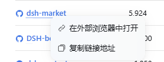
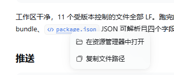
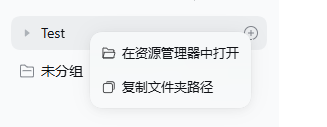

# dsh-right-click-menu

[English](README.md) | 中文

为 DSH Web GUI 补上鼠标右键。右键**文件引用**会在文件管理器中定位它，右键**链接**会在外部浏览器中打开，右键左侧栏的**工作区项目**会打开该目录。

## 为什么需要它

桌面壳在 Electron 主进程（`lib/main.js`）里构建右键菜单，且只处理两种情况：

```js
window.webContents.on("context-menu", (_event, { isEditable, selectionText, editFlags }) => {
  const items = [];
  if (isEditable) items.push(/* undo, redo, cut, copy, paste, select all */);
  else if (selectionText.length > 0) items.push({ role: "copy" });
  if (items.length > 0) Menu.buildFromTemplate(/* … */).popup({ window });
});
```

`items` 为空就完全不弹菜单。所以在 Markdown 链接、`@` 文件引用、交付卡片、右侧栏文件树行上右键，目前毫无反应。本插件在页面内接管这些右键，提供产品本身已经具备的两个能力。

## 它做什么

| 右键对象 | 菜单项 |
|---|---|
| HTTP(S) 链接 —— Chat/助手 Markdown、行内代码 URL | **在外部浏览器中打开** · 复制链接地址 |
| 文件引用 —— Markdown 文件链接、`@path` 芯片、交付卡片、文件树行、文档路径标签 | **在资源管理器中打开** · 复制文件路径 |
| 目录 —— 左侧栏工作区项目、`@folder/` 芯片、文件树目录行、文件树标题 | **在资源管理器中打开** · 复制文件夹路径 |

文案跟随当前界面语言。插件在英文词典之外注册了简体中文词典（`在外部浏览器中打开`、`在资源管理器中打开`、`复制文件路径`、`复制文件夹路径`），两种语言下都通顺。

其余右键一律保持原样：可编辑区域仍用原生的撤销/剪切/复制菜单，选中文本仍用原生的复制菜单。菜单用的是共享的 `Menu` 原语，因此排序、键盘导航（方向键、Tab、Escape）、焦点归还、点击外部关闭、主题联动都是产品自身的行为。

### 截图

在中文界面下截取；文案跟随当前语言。

| 链接 | 文件引用 | 工作区项目 |
|---|---|---|
|  |  |  |

### 两个动作分别怎么实现

- **在外部浏览器中打开**复用产品自己的外链跳转通路：`window.open(url, "_blank", "noopener,noreferrer")`。Electron 主进程拦截 `_blank` 开窗并交给 `shell.openExternal`，所以这和左键点击 Chat 链接走的是同一条路。
- **在资源管理器中打开**走 Session Remote 的 `session.openWorkspacePath`，请求内容取决于点到的是什么 —— 与产品自己的目录控件、文件控件采用同一套区分：
  - **目录**直接在文件管理器中打开（`{ path }`，不带 `action`），所以工作区项目是"进到里面去"，而不是在父目录里把它高亮一下；
  - **文件**在它所在的位置定位（`{ path, action: "reveal" }`），因为"在资源管理器中打开"绝不能变成"用它的默认程序打开它"。

  两种情况 Host 都会先用组合文件系统校验路径再驱动桌面，因此插件本身不碰文件系统，也无法越出该 Session 的权限。

第二行会说明目标到底是什么 —— 文件是 `复制文件路径`（`Copy file path`），目录是 `复制文件夹路径`（`Copy folder path`）。某类目标拿到哪一组行由纯函数 `menuRowsFor(target, t)` 决定，所以这段文案无需渲染器即可断言。

Session Remote 会把相对路径按 Host 进程目录解析，所以插件先把路径变成绝对路径 —— 取自左侧栏的 Workspace 列表（项目行只带 Workspace id）、文件树自身的 `data-files-root`，或主视图保留的那个 Session 的 `cwd`（用于工作区相对的 Markdown 链接）。

## 目录结构

```
package.json             bundle + 插件声明（`dsh.bundle`、`dsh.client`）
cordis.patch.yml         该 bundle 插入的唯一一行 Loader 条目
lib/index.js             宿主半侧 —— 空 `apply`，这是纯 UI 插件
lib/client.js            浏览器半侧 —— 全部功能
test/detection.test.mjs  零依赖测试
scripts/live-bundle.mjs  针对运行中 Host 的活体校验
```

`lib/client.js` 直接按模块系统的 factory-CJS 形态书写（`window.__ModuleLoader__.load({ id, factory })`），与构建产物完全一致，因此本包**不需要构建步骤**。它只请求 `react`、`react/jsx-runtime`、`@deepseek-ai/dsh-client-ui-primitives` 三个模块，三者都在外壳冻结的平台模块表内。

## 开发

无构建步骤、无依赖、无测试框架：

```sh
npm test              # node test/detection.test.mjs
npm run check:live    # node scripts/live-bundle.mjs [baseUrl]
```

`npm test` 按模块系统的方式加载 `lib/client.js`（平台模块以桩替代），断言 factory 形态与 slot/词典注册，然后**从交付的源码里抽出 bundle 自身的纯函数段**，喂给按各 DSH 界面真实渲染结构搭建的模拟 DOM —— 所以测试不会与代码的副本产生分叉。

`npm run check:live` 复现 Host 的 `artifactRevision`（对 `mtimeMs`/`ctimeMs`/`size` 做 `framedHash`），请求组合路由 `/plugins/??<name>/client.js&rev=<rev>`，并断言响应以磁盘上的字节开头。地址默认取 `$DSH_WEB_URL`，否则 `http://127.0.0.1:19387`；插件名与 bundle 路径都读自本包自己的 `package.json`。

改动 `lib/client.js` 无需重新构建：Host 依据文件元数据推导 bundle 版本，保存后即通过客户端 HMR 送达已打开的页面。

## 兼容性

针对 **DSH `0.2.0-rc.2`**（桌面运行时，Electron Web GUI）构建并验证。

这是 **Web surface** 插件：它需要一个页面来挂载 document 监听器。在 headless 或 SDK profile 下根本没有浏览器半侧，因此插件是"不起作用"，而不是"坏了"。

插件刻意只依赖公开的插件接口 —— `ctx.slots`、`ctx.locale`、Session Remote 的 `session.openWorkspacePath`、客户端 Workspace 列表，以及 `dsh-client-ui-primitives` 导出的 `Menu`/`Toast`/图标。这些都没有私有副本。

但**检测**读取的是 DSH 未作为 API 发布的标记。这些是脆弱点，全部集中在一处（`lib/client.js` 的 `filePathOf`），且全部有测试覆盖，但可能随 DSH 版本变动：

| 标记 | 归属 |
|---|---|
| `data-row-key="workspace:<id>"` | 左侧栏项目行（`client/ui-workspace`） |
| `data-files-path`、`data-files-root`、`data-files-entry` | 右侧栏文件树（`client/ui-sidebar-files`） |
| `data-ref-chip="file"\|"folder"` | `@` 引用芯片（`client/ui-primitives`） |
| 匹配 `fileLink` / `fileMention` 的类名 | Markdown 文件链接（生成的 CSS module 类名） |
| 按钮/链接上指向绝对路径的 `title` | 交付卡片、路径标签 |

若某次 DSH 升级后菜单失效，`npm test` 可以定位：失败的用例会点名出问题的界面，修复点就是上表里的某个标记。

### 版本兼容闸门

其中一部分由 DSH 自己强制。在 profile 导入插件之前，DSH 会把包的 `peerDependencies` 里 `@deepseek-ai/dsh` 与 `@deepseek-ai/dsh-*` 的声明，对照 `getDshRuntimeVersion()` 返回的**唯一**运行时版本逐一检查，每个声明的区间都必须匹配。**未声明 DSH peer 则不施加任何约束**，区间非法即视为不兼容，而且这项检查看的是 peer 声明，**不是** `engines.dsh`。bundle 的检查发生在 profile 加载各 bundle 层时（启动时以及每次重组），不兼容的 bundle 会被跳过并列入 `skippedBundles`。

因此本包声明了它所针对的运行时包：

```json
"@deepseek-ai/dsh-api-session-controller": "^0.2.0-rc.2",
"@deepseek-ai/dsh-client-modules": "^0.2.0-rc.2",
"@deepseek-ai/dsh-client-ui-primitives": "^0.2.0-rc.2"
```

于是它只在 `0.2.0-rc.2 <= v < 0.3.0` 下加载，其它版本会被拒绝，而不是半可用。这是有意的：上面的检测依赖 DSH 未公开的标记，因此未经核验的运行时应当直接拒绝这个插件，而不是悄悄弹出一个已经对不上 DOM 的菜单。

## 规范与收录

### 运行时真正强制的要求

下列要求由 DSH 自身强制，是从交付的构建里读出来的，不是社区建议：

| 要求 | 由谁强制 |
|---|---|
| `dsh.bundle.patch` 才算 bundle，`dsh.client.platform` 才带浏览器半侧 | Loader 扫描与 `client-modules` |
| ESM（`"type": "module"`）＋ 相对路径的 `main`/`exports` | Node 解析 |
| `exports["./client"]` 指向已构建的浏览器 bundle | `client-modules` 会拒绝 `./client` 缺失或格式错误的包 |
| 读到的每个 Cordis 服务都写进 `inject` | Cordis 拒绝未声明的 `ctx.x` 读取 |
| `files` 必须包含该 bundle | 打包层面：漏掉它的 tarball 装不上 |
| 针对目标运行时声明 `@deepseek-ai/dsh*` peer | [版本兼容闸门](#版本兼容闸门) |

另有两条来自"如何交付一个包"、而非运行时强制：注入哪些 Cordis 服务就声明哪些；README 保持中英成对（`README.md` + `README.zh.md`），并带 `English | 中文` 切换 —— 这是 DSH 代码树里每个包的写法。

### 没有官方投稿通道

DSH **不提供**第三方插件 registry、目录接口或投稿流程，构建里也没有引用任何这类东西。插件页的**官方**分组由 `plugins.item` slot 填充，而注册它的是**随运行时一起发布**的包（那些官方配置页）；页面上的 bundle 列表就是 profile 自己的依赖列表。所以"官方"的含义是"DeepSeek 随包发布"：第三方插件没有任何可投稿的地方。

发现渠道在生态里 —— 发到 npm 或 Git，并给仓库打上 `dsh-plugin` topic。社区目录与精选列表会据此找到你；它们由社区运营、与 DeepSeek 无关，并且各自有验证标准，因此被收录只应视为起点，而不是背书。

## 安装

把包装进为该 GUI 提供服务的 profile。推荐的路径是插件管理器，它会添加依赖**并**把 bundle 追加进 profile 的 `dsh.profile.bundles`：

```
plugin_manager install_bundle  target: <spec>
```

或者手工操作，在 profile 目录下：

```sh
pnpm add <spec>
```

然后把包名追加进 profile 的 `package.json` 的 `dsh.profile.bundles`。

`<spec>` 是包管理器接受的任意 bundle 来源：registry 包名（`dsh-right-click-menu`）、Git 地址（`github:SJcun/dsh-right-click-menu`）、tarball，或本地检出的绝对路径。用插件管理器安装会同时完成"加依赖"和"选中 bundle"两件事；手工安装则两件都要做。

宿主半侧在下次 Host 启动时加载，若启用了配置 HMR 则立即生效；浏览器半侧随下一次页面加载生效。无论哪种，请用 `npm run check:live` 确认，而不是靠猜。

## 停用与卸载

在 profile 的 `cordis.patch.yml` 给 `right-click-menu` 条目加 `disabled: true`，或从 `dsh.profile.bundles` 移除该 bundle。移除 bundle 会一步带走监听器与菜单 —— 不存在第二份行为残留。

## 验证

1. 在 Chat 消息里右键 HTTP(S) 链接 → 出现「在外部浏览器中打开」（英文 `Open in external browser`），并在系统浏览器中打开。
2. 右键消息里的 `@` 引用文件、交付卡片或右侧栏文件树行 → 出现「在资源管理器中打开」（英文 `Show in File Explorer`），并在资源管理器中选中该文件。
3. 右键左侧栏的工作区项目名 → 出现「在资源管理器中打开」，并在资源管理器中打开该目录。
4. 右键消息输入框或选中的文本 → 原生菜单不变。

### 会接管的目标

右键按下后按下列顺序、由内向外逐层向上找，因此嵌在里面的图标或文字也能归到它自己的控件：

| # | 标记 | 解析为 |
|---|---|---|
| 1 | `<a href="http(s)://…">` | URL |
| 2 | `data-row-key="workspace:<id>"` —— 左侧栏项目行 | 目录，读自 `ctx.workspaces.list` |
| 3 | `data-files-path` / `data-files-root` / `data-files-entry` —— 右侧栏文件树 | 文件或目录 |
| 4 | `data-ref-chip` = `file`/`folder`、Markdown 文件链接类名，或指向绝对路径的按钮/链接 `title` | 文件或目录 |

## 已知限制

- 路径按图片渲染的 Markdown 文件链接没有 `title`（它的悬浮提示被图片预览占用），因此只有当它自身的标签就是路径时才能识别。
- 项目行经客户端 Workspace 列表解析，因此需要已知的 `workspaceId`；侧栏共享的**未分组**桶 id 为空，刻意不提供菜单。
- 右侧栏的应用内浏览器标签页保持自身的原生行为；只有 HTTP(S) 锚点会被接管。
- 工作区相对的 Markdown 链接按主视图保留的那个 Session 的工作区解析。因此来自子代理记录、指向另一个工作区的链接，会相对于当前查看的 Session 来定位。

## 发布

本包通过仓库分发，而非 npm。`package.json` 不带 `private` 守卫，所以用 Git 或 tarball 安装无需改动，而一旦发布 `pnpm add dsh-right-click-menu` 即可用 —— 撰写时该包名在 npm 上未被占用。`repository`、`bugs`、`homepage`、`author` 均已填好；fork 应把它们指向自己的地址。

`npm pack --dry-run` 列出的就是 tarball 的全部内容：`package.json`、`LICENSE`、两份 README、它们引用的三张截图、`cordis.patch.yml`、`lib/index.js`、`lib/client.js`。`test/` 与 `scripts/` 留在仓库里。
